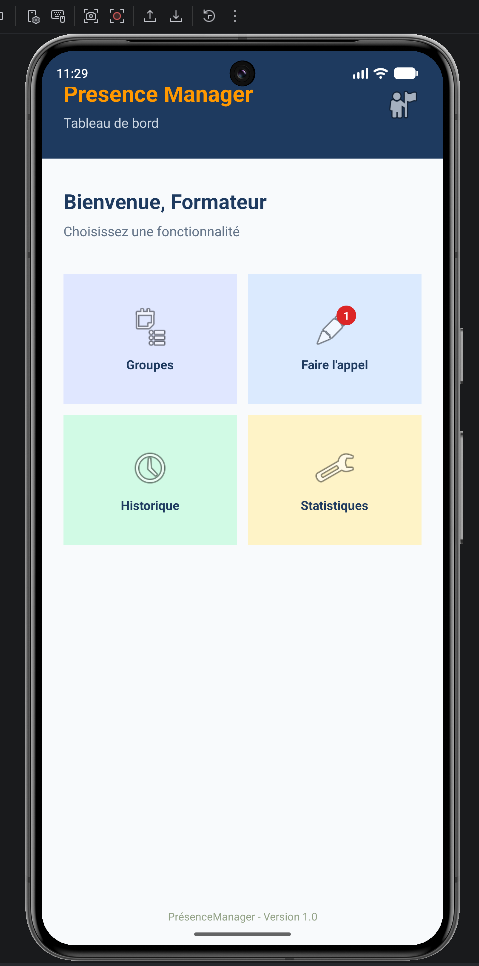

# PrésenceManager

Application Android de gestion des présences des stagiaires.

## TP01 : Création de l'interface d'accueil
Conception de l'interface graphique de la page d'accueil (`activity_main.xml`) en respectant la maquette, les dimensions, les couleurs et les espacements exigés.

### Capture d'écran réelle :

 ## TP02 — Tableau de bord (PresenceManager)[cite: 1]

Ce projet correspond au deuxième TP (TP02) de l'application **PresenceManager**, réalisé dans le même projet Android que le TP01[cite: 1]. Il consiste à intégrer et concevoir l'interface utilisateur du **Tableau de bord** (Dashboard)[cite: 1] destinée aux formateurs, comprenant :
- Un en-tête (Header) avec le nom de l'application et les informations de profil.
- Un message de bienvenue personnalisé.
- Une grille interactive (GridLayout) de 4 cartes fonctionnelles (Groupes, Faire l'appel avec un badge de notification, Historique et Statistiques).

### Capture d'écran (Dashboard)[cite: 1]
*(N'oublie pas d'ajouter ta vraie capture d'écran ici dans le dossier du projet et de l'insérer comme ceci)*

